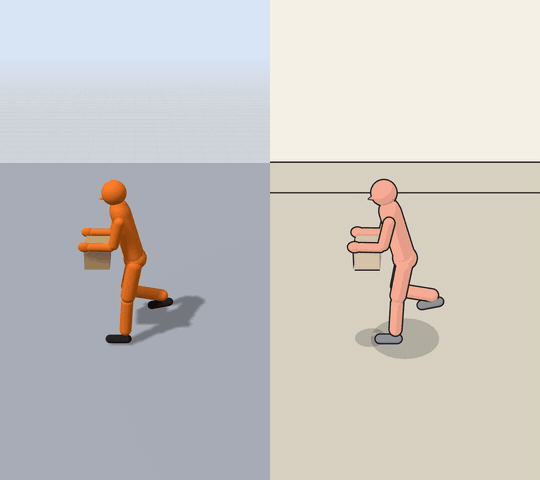
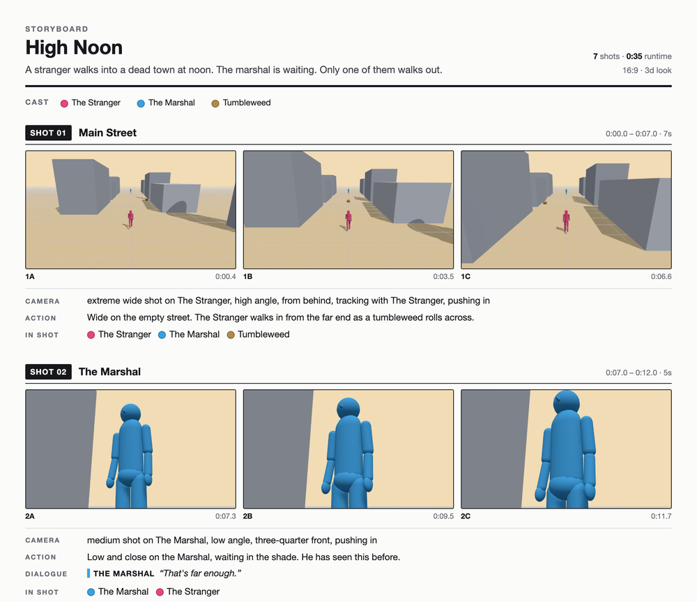
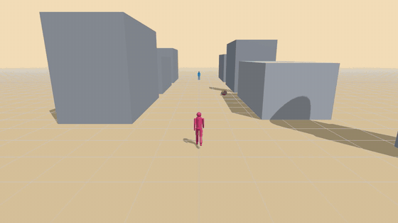
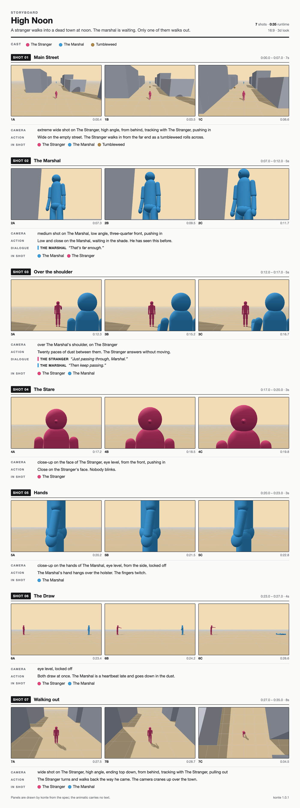
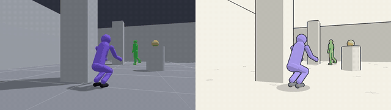
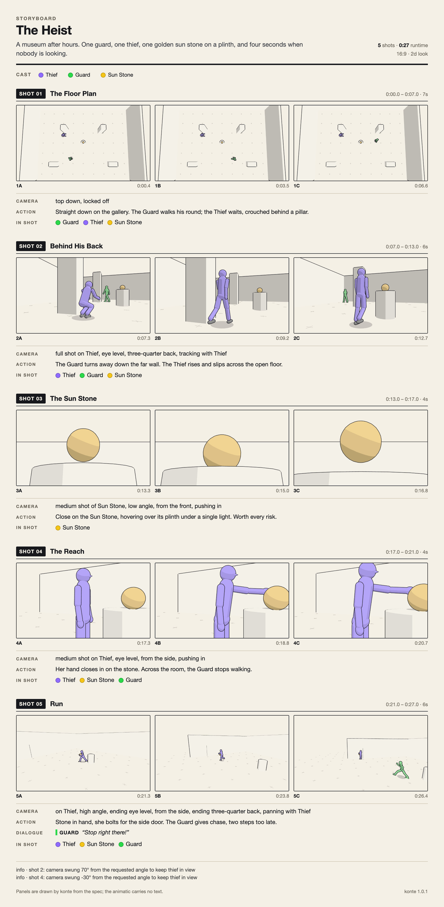
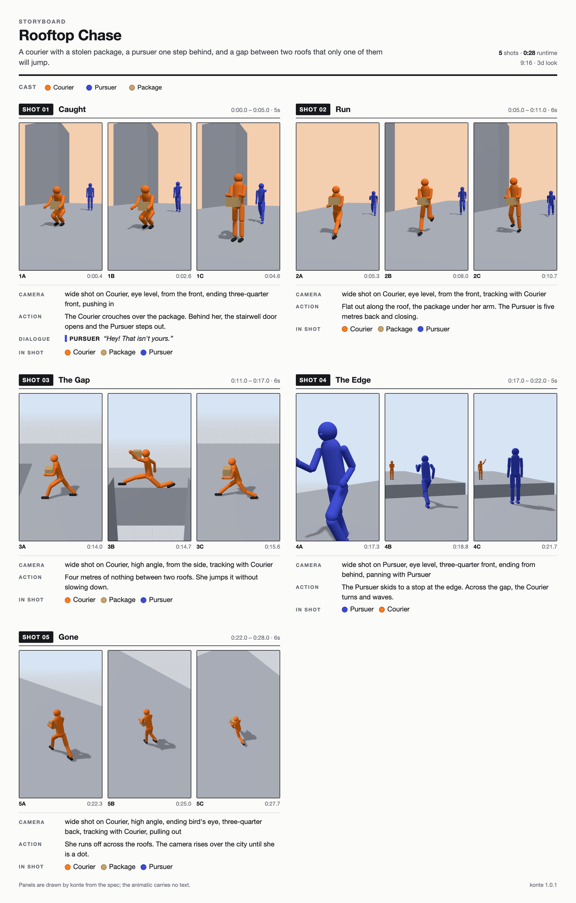
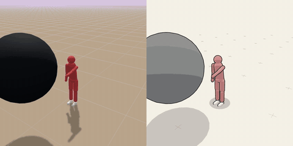
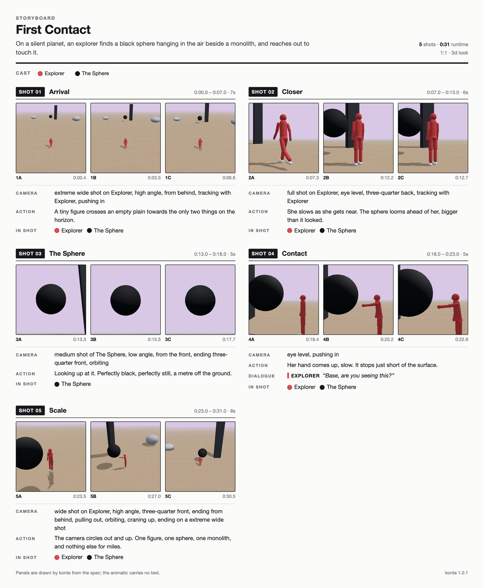
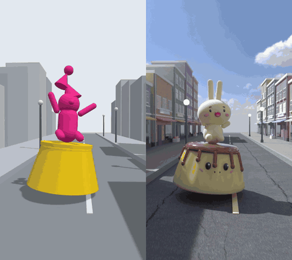

<div align="center">

# konte

**Turn a JSON shot list into a film-style storyboard sheet and a rough animatic, before you pay a video model to generate anything.**

[](https://www.npmjs.com/package/@sshworld/konte)
[](https://github.com/sshworld/konte/actions/workflows/ci.yml)
[](package.json)
[](LICENSE)

[Quick start](#quick-start) · [Gallery](#gallery) · [Write a spec](#write-a-spec) · [CLI](#cli) · [Claude Code plugin](#claude-code-plugin) · [Video models](#using-the-clips-with-a-video-model) · [FAQ](#faq)


&nbsp;


<sub>Left: shot 3 of <code>rooftop-chase</code>, in the 3d and 2d looks. Right: the top of the storyboard sheet for <code>high-noon</code>.</sub>

</div>

---

konte reads a shot list written as JSON and draws two things from it:

- **A storyboard sheet**, laid out like the boards used on a film production: numbered panels for every shot with their timecodes, and under them the camera in words, the action, the dialogue and who is in the shot.
- **An animatic with no text in it**: grey sets, one coloured mannequin per character, and the camera you described, cut shot by shot. Each shot is also saved as its own clip, with prompts, for video models that take a reference video, such as Seedance and Kling.

Everything runs locally. There is no model, no account and no hosted service, and no dedicated GPU is needed. The staging is computed, not generated, so the same spec gives the same shots, and a person or an agent can lint it, diff it and regenerate it from a script.

## Quick start

You need **Node 22+**, **Chrome or Chromium**, and **ffmpeg** (ffmpeg only for video; `--board-only` works without it). On macOS: `brew install ffmpeg`.

```bash
npx @sshworld/konte render rooftop-chase
```

`rooftop-chase` is one of four bundled examples. To keep the `konte` command around, install it globally:

```bash
npm install -g @sshworld/konte
konte render rooftop-chase
```

The files land in `./konte-out/<title>/`, where the title is made safe for a folder name (`Rooftop Chase` becomes `Rooftop-Chase`). Use `-o` to choose the folder.

```text
konte-out/Rooftop-Chase/
├── board-3d.png          the storyboard sheet: panels, camera, action, dialogue, cast
├── board-2d.png          the same sheet in the ink-on-paper look
├── sketch-3d.mp4         the animatic, picture only
├── sketch-2d.mp4
├── shots/
│   ├── 01-3d.mp4         one clip per shot, cut on exact frames
│   ├── 01-3d-first.png   its first and last frame, for image-to-video models
│   └── 01-3d-last.png    ...
├── prompts.md            two prompts per shot for a video model
└── shots.json            shot metadata and the list of files written, for scripts
```

On an M1 Pro laptop with konte 1.0.1, `konte render high-noon` (35 seconds, seven shots, both looks, default 12 fps) took about 23 seconds end to end; `--board-only` took about 5 (about 2 per look).

## Features

- **Storyboard sheets.** A header with the title, logline, runtime and a cast legend; one card per shot with up to four panels (1A, 1B, ...), timecodes read from the frames actually drawn, and Camera, Action, Dialogue and In shot rows.
- **Text-free video.** No titles, captions, name tags or timecodes in the picture, in the animatic, the shot clips or the review copy. Every word is on the sheet and in `prompts.md`.
- **Shots written the way a storyboard writes them.** `"size": "FS", "angle": "side", "move": "track"`. konte solves where the camera stands and swings it round a wall that blocks the view.
- **Staging checks before drawing.** `konte lint` reports a subject out of frame, a camera inside a wall, someone running at 15 m/s or sliding while standing.
- **Two looks from one staging.** `3d` is a lit greybox; `2d` is ink and flat tone on paper.
- **Rough on purpose.** Mannequins and boxes, so you judge blocking, framing and timing, not faces or textures.

## Gallery

Every image below was drawn by konte from the JSON in [`examples/`](examples). The animations are excerpts; click a board to see the whole sheet.

<table>
<tr>
<td width="50%" valign="top">

**[High Noon](examples/high-noon.json)** · 16:9 · 7 shots · 35 s<br>
A western standoff: the empty street, an over-the-shoulder exchange, a close-up on the hands, and the draw. <sub>Excerpt: shots 1, 3 and 6.</sub>



[](media/high-noon-board.png)

</td>
<td width="50%" valign="top">

**[The Heist](examples/the-heist.json)** · 16:9 · 5 shots · 27 s<br>
A thief slips behind a patrolling guard, lifts a stone off its plinth and runs for the door. <sub>Excerpt: shot 2 in both looks. Board in the 2d look.</sub>



[](media/the-heist-board.png)

</td>
</tr>
<tr>
<td width="50%" valign="top">

**[Rooftop Chase](examples/rooftop-chase.json)** · 9:16 · 5 shots · 28 s<br>
A vertical chase across the roofs, with the gap jump timed to the frame. <sub>Shot 3 is the animation at the top of this page.</sub>

[](media/rooftop-chase-board.png)

</td>
<td width="50%" valign="top">

**[First Contact](examples/first-contact.json)** · 1:1 · 5 shots · 31 s<br>
An explorer, a black sphere hanging in the air, a monolith, and an orbit that shows the scale. <sub>Excerpt: shot 5 in both looks.</sub>



[](media/first-contact-board.png)

</td>
</tr>
</table>

### From animatic to final

The animatic is only the plan. Here it is next to a finished piece built on top of it: the same blocking, timing and camera, rendered with a character, a pudding and a meadow road.

<div align="center">


<sub>Left: the konte animatic. Right: a finished 3D render that follows it shot for shot. An 8-second excerpt of a 20-second, 9:16 piece.</sub>
</div>

## Write a spec

A spec is a cast and a list of shots. Save this as `standoff.json`:

```json
{
  "konte": 1,
  "title": "Standoff",
  "aspect": "16:9",
  "cast": {
    "stranger": { "label": "The Stranger", "color": "#e8457e" },
    "marshal":  { "label": "The Marshal",  "color": "#3aa0e0" }
  },
  "scenes": [
    {
      "title": "Over the shoulder", "seconds": 5,
      "note": "Twenty paces of dust between them. The Stranger answers without moving.",
      "dialogue": [["stranger", "Just passing through."], ["marshal", "Then keep passing."]],
      "actors": [
        { "who": "stranger", "at": [0, 7],  "face": 180, "do": "stand+talk", "look": "marshal" },
        { "who": "marshal",  "at": [0, -5], "face": 0,   "do": "stand",      "look": "stranger" }
      ],
      "camera": { "on": "stranger", "over": "marshal" }
    }
  ]
}
```

```bash
konte lint standoff.json                  # check the staging, draw nothing
konte render standoff.json --board-only   # the sheets alone, in a few seconds
konte render standoff.json                # sheet, animatic, shot clips and prompts
```

- **Cast** members are people (a mannequin in their colour) or objects (box, ball, cylinder, bottle, shoe). Colour is how you tell them apart across cuts; the sheet's cast legend says who is which.
- **Actors** stand `at` a point or follow a timed `path`, and `do` actions such as `walk`, `run`, `sit`, `kneel`, `leap`, `reach`, `talk` or `carry`, alone or combined (`"run+carry"`). A `jump` lifts them along an arc.
- **Camera** is written as a shot: `size` (`ECU` to `EWS`), `angle`, `height`, `move` (`track`, `push`, `pull`, `orbit`, `crane-up`, ...), over the shoulder with `over`, or an exact position when you need one.
- **Words** go in `title`, `note` and `dialogue`. They appear on the sheet and in the prompts, never in the video.

The full reference, with every key, unit and default, is **[docs/spec.md](docs/spec.md)**.

## CLI

```text
konte lint   <spec.json>             check a spec without drawing anything
konte render <spec.json> [options]   draw the storyboard sheet and the animatic
konte render <example>               draw a bundled example: first-contact, high-noon, rooftop-chase, the-heist
konte --help | --version
```

| Option | Default | |
|---|---|---|
| `-o, --out <dir>` | `./konte-out/<title>` | Where to write. Specs with the same title share a folder, so give each its own `-o` if you keep several. |
| `--look <3d,2d>` | `3d,2d` | Which looks to draw: `3d`, `2d` or both |
| `--board-only` | | Write the storyboard sheet and nothing else (no ffmpeg needed) |
| `--review` | | Also write `review-<look>.mp4`: the animatic with each actor's path drawn on the floor. Still no text. |
| `--fps <n>` | spec's `fps`, else 12 | Frames drawn per second of story, 1 to 60. Each is held for a whole number of video frames, so the mp4 plays at 24 fps or more. |
| `--jobs <n>` | half the cores, up to 6 | Browser windows drawing frames at once (at most 12) |

If Chrome is not in a standard place (Windows, a custom install), point `CHROME` at the executable, for example `CHROME="/opt/chrome/chrome" konte render spec.json`.

A spec that cannot be read stops before anything is drawn. Staging errors found by lint are printed, the files are still written, and the command exits with status 1.

A full render replaces the files konte wrote in that folder before, and removes clips an earlier render listed in its `shots.json` but this one did not write, so an old clip cannot pass for a current one. It never deletes files it has no record of writing, but it does overwrite its own file names. `--board-only` only replaces the board, and says so when older videos are beside it.

## Claude Code plugin

konte ships as a Claude Code plugin with a skill, so Claude can storyboard an idea you describe in words:

```text
/plugin marketplace add sshworld/konte
/plugin install konte@konte
```

Then ask, for example:

```text
Using konte, storyboard a 30-second heist in five shots. Show me the board before rendering the animatic.
```

The skill has Claude write the spec, lint it, draw the board first, revise until the board tells the story, and only then render the video. See [skills/konte/SKILL.md](skills/konte/SKILL.md).

## Using the clips with a video model

> **Untested.** konte's clips and prompts have not yet been tried with Seedance, Kling, Higgsfield or any other video model. The notes below come from the vendors' documentation, read in November 2026.

Some video models accept a reference video and use it to guide camera, pacing and blocking. ByteDance's Seedance 2.5 announcement describes a "clay render" reference built from untextured 3D models; konte's `3d` clips are that kind of picture.

1. `konte render spec.json --look 3d`
2. Open `prompts.md`. Each shot lists its files in `shots/` and two prompts. The prompts name the colours of the first look you render.
3. Attach the shot's clip as the reference video, paste prompt A, and add your own character, product and style references.

| Model | What goes in | What its documentation says |
|---|---|---|
| Seedance 2.5 | The clip, as a reference video | Up to 10 reference videos in one pass; output up to 30 seconds. No limit is given for a reference clip's length. ([ByteDance](https://seed.bytedance.com/en/blog/one-take-creation-flexible-referencing-introducing-seedance-2-5)) |
| Seedance 2.0 | The clip, named `@Video1` in the prompt | Up to 3 reference videos, 2 to 15 seconds combined, under 50 MB in total. ([fal.ai](https://fal.ai/docs/model-api-reference/video-generation-api/bytedance-seedance-2.0-reference-to-video.md)) |
| Kling 4.0, Omni Reference | The clip, also `@Video1` | Up to 5 videos, 3 to 30 seconds each, 30 seconds in total. ([Kling guide](https://kling.ai/quickstart/kling-4-model-user-guide)) |
| Image-to-video models, such as Seedance 1.5 Pro | `-first.png`, and `-last.png` where the model takes an end frame | No reference video. Restyle the still with an image model first, then use prompt B, which describes the motion in words. |

The Seedance 1.5 row rests on provider pages that list only image and text inputs. Platforms and versions differ; check the one you use. `konte lint` notes shots longer than 15 or 30 seconds as information only; it does not check file size, resolution or a platform's combined limits.

## How it works

```text
spec.json ──► src/stage.js ──► konte lint
                  │
                  ├──► src/render.html (Three.js in headless Chrome) ──► frames ──► ffmpeg ──► sketch, shots/
                  ├──► storyboard sheet (HTML, screenshotted)        ──► board-<look>.png
                  └──► src/prompts.js                                ──► prompts.md
```

`src/stage.js` is a pure model: given a spec and a time, it says where everyone is and where the camera is. Lint, the renderer and the prompt text all run on it, so lint judges the same positions that get drawn and the camera words are measured from the solved camera. The CLI serves the renderer on a local port, drives it in headless Chrome over several windows and pipes the frames to ffmpeg. The renderer page has no text layer; the sheet is a separate page built from the same model.

## FAQ

**Can I write the spec in another language?**
Yes. Titles, notes, dialogue and labels appear on the sheet exactly as written. On Linux, install a font that covers your script (for Korean, Japanese or Chinese, `fonts-noto-cjk`).

**Why is there no text in the video, not even a shot number?**
The video is a reference, not a deliverable. Text in a reference clip may be reproduced in the generated output, and it gets in the way when you watch for timing. The sheet holds every word.

**Does it make the final video?**
No. There are no faces, no lighting design and no physics. konte is the pencil sketch that comes before generation or a shoot.

**Is there an editor?**
No. You change the picture by changing the file, which is what makes it easy for an agent to work with.

**Where does the name come from?**
*Konte* is the everyday word for a storyboard on Korean and Japanese productions.

## When to use something else

- For an interactive 3D studio in the browser, with rigged characters, a timeline and an agent panel, use [CozyClay](https://github.com/HaD0Yun/CozyClay). It covers the same greybox-to-video-model idea with far more control.
- For a finished, editable promo drawn in code, use [video-shotcraft](https://github.com/Vincentwei1021/video-shotcraft).
- Choose konte when you want the staging in a text file you can diff, lint and regenerate from a script or an agent, running locally with no account.

## License

[MIT](LICENSE). Three.js is bundled under its own MIT license in [`vendor/`](vendor).
