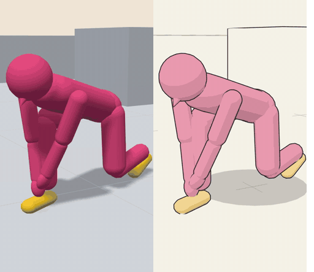
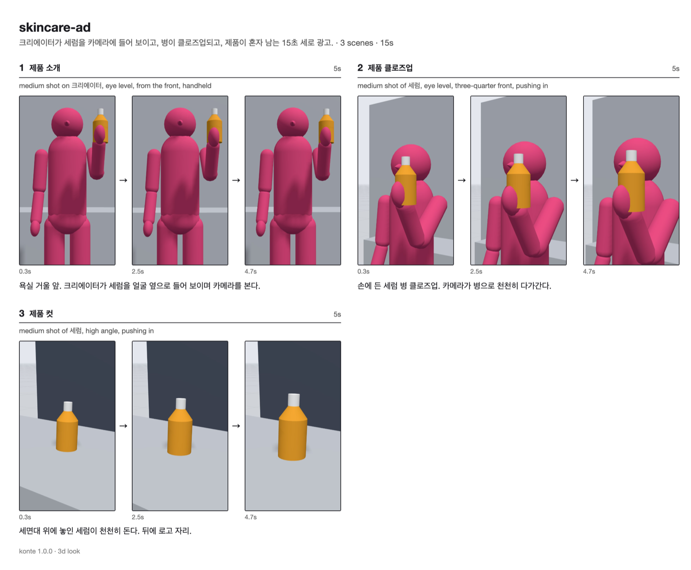
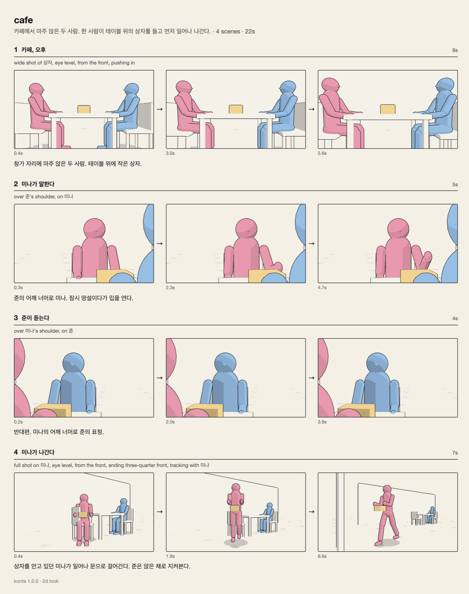

# konte

**AI video storyboard and animatic generator. See the video before you pay to generate it.**



One JSON file in, one command, no window to open. konte draws a rough previs video, a storyboard image, and one reference clip with two prompts per shot, meant for video models that take a reference video, such as Seedance and Kling. No model, no GPU bill, no app to learn: an agent (or you) writes a spec, a fixed renderer draws it.

스토리보드(콘티) JSON 하나로 러프한 애니매틱 영상, 콘티 보드, 샷별 참고 클립과 프롬프트를 만듭니다. Seedance · Kling · Higgsfield 같은 AI 영상 모델에 돈을 쓰기 전에 연출과 카메라, 타이밍을 먼저 확인하는 도구입니다.

```
npx github:sshworld/konte render sneaker-ad
```

Needs Node 22 or later, Chrome or Chromium, and ffmpeg. `sneaker-ad` is one of four specs that ship with konte; give a path to draw your own.

> **What has and has not been checked.** Everything on this page was drawn by konte, and its staging model is covered by tests. Its clips and prompts have **not yet been tested with Seedance, Kling, Higgsfield or any other video model**. The model notes below come from the vendors' documentation.



With Claude Code, after installing the plugin, you can ask in words:

```
Using konte, storyboard a 15-second vertical skincare ad in three shots.
Show me the board before rendering the animatic.
```

## Why

A text-to-video run costs money and minutes, and a first generation can show that the idea itself was unclear: the camera was on the wrong person, the jump took five seconds, two scenes said the same thing. Those are staging problems, and staging does not need a diffusion model.

konte is the pencil sketch that comes first:

- **Rough on purpose.** Grey sets, one coloured mannequin per character. You judge blocking, framing and timing, and nothing else distracts you.
- **Whole pieces, not single shots.** Many scenes, minutes long, with cuts. Characters keep their colour across them.
- **Written like a storyboard.** `"size": "FS", "angle": "side", "move": "track"`. konte works out where the camera goes and looks for another angle when a wall is in the way.
- **It catches staging mistakes before drawing.** `konte lint` reports a subject out of frame, a camera inside a wall, someone running at 15 m/s or sliding while standing. It samples a simplified scene, so it is a first check, not a guarantee.
- **Two looks from one staging.** `3d` is a lit greybox, `2d` is ink and flat tone on paper.
- **No words on the video.** The picture is the picture. Notes live on the board and in `prompts.md`, which leaves the clips clean for use as reference video.
- **Cut for video models.** Each scene is also written as its own clip in `shots/`, cut on exact frames, with its first and last frame as stills and prompts that say which coloured figure is which character and describe, from the solved staging, each one's actions with their times and the camera.

## When to use something else

konte is a command and a text file. That is its whole point, and its limit.

- For an interactive 3D studio in the browser, with rigged characters, a timeline, depth passes and an agent panel, use [CozyClay](https://github.com/HaD0Yun/CozyClay). It covers the same greybox-to-video-model idea with far more control, and its README shows results from a video model.
- For a finished, editable promo drawn in code, use [video-shotcraft](https://github.com/Vincentwei1021/video-shotcraft).
- Choose konte when you want the staging in a file you can diff, lint and regenerate from a script or an agent, with no server, no account and an MIT licence.

## Install

```
npm install -g github:sshworld/konte
```

If Chrome is somewhere konte does not look (Windows, a custom install), set `CHROME` to its executable.

As a Claude Code plugin, so that Claude sketches an idea when you describe one:

```
/plugin marketplace add sshworld/konte
/plugin install konte@konte
```

## Use

```
konte lint   spec.json                 check a spec without drawing anything
konte render spec.json                 board, sketch video, shot clips and prompts, both looks
konte render spec.json --board-only    just the board, in a second
konte render spec.json --look 3d --review
```

| Option | |
|---|---|
| `-o, --out <dir>` | Where to write. Default `./konte-out/<title>` |
| `--look <3d,2d>` | Which looks to draw. Default both |
| `--review` | Also write `review-<look>.mp4`, with a slate strip, name tags and travel lines |
| `--captions` | Like `--review`, with each scene's note under the picture |
| `--fps <n>` | Frames drawn per second of story. Default the spec's, else 12. Each drawn frame is held for a whole number of video frames, so the mp4 plays at 24 fps or more |
| `--board-only` | Write the board and nothing else |
| `--jobs <n>` | Browser tabs drawing frames at once |

```
konte-out/sneaker-ad
  board-3d.png       the storyboard
  sketch-3d.mp4      the animatic, 60 seconds
  shots/NN-3d.mp4    4 clips, each with -first.png and -last.png
  prompts.md         two prompts per shot
  shots.json         what was written, for scripts
```

On a 10-core laptop, one run of this 60-second, four-scene piece took about 18 seconds for one look; the board alone took about a second. Yours depend on the machine, the length and the frame rate.

A render replaces what konte wrote in that folder before, and removes the clips and prompts an earlier render listed in its `shots.json` and this one did not write again, so an old clip cannot pass for a current one. It does not touch files it has no record of writing. A video is written under a temporary name and only takes its real name when it is complete.

## A proposed workflow for Seedance and Kling (untested)

Some video models accept a reference video and use it to guide motion and camera; how closely they follow it varies. ByteDance's Seedance 2.5 announcement describes a "clay render" reference, built from textureless 3D models, for camera movement, pacing, subject path and blocking. konte draws that kind of clip. Whether a given model follows a konte clip well is exactly what has not been tested yet.

1. `konte render spec.json --look 3d`
2. Open `prompts.md`. Each shot lists its files in `shots/` and two prompts.
3. In a model that takes a reference video, attach the shot's clip, paste prompt A, and add your own character, product and style references.

| Model | What goes in | What its documentation says |
|---|---|---|
| Seedance 2.5 | The clip, as a reference video | Up to 10 video clips as references in one pass; output up to 30 seconds. No length limit for a reference clip is given. ([ByteDance](https://seed.bytedance.com/en/blog/one-take-creation-flexible-referencing-introducing-seedance-2-5)) |
| Seedance 2.0 | The clip, named `@Video1` in the prompt | Up to 3 reference videos, 2 to 15 seconds combined, under 50 MB. ([fal.ai reference](https://fal.ai/docs/model-api-reference/video-generation-api/bytedance-seedance-2.0-reference-to-video.md)) |
| Kling 4.0, Omni Reference | The clip, also `@Video1` | Up to 5 videos, 3 to 30 seconds each, 30 seconds in total, 300 MB each. ([Kling guide](https://kling.ai/quickstart/kling-4-model-user-guide)) |
| Models that start from an image, such as Seedance 1.5 Pro | `-first.png` and `-last.png`, after restyling | No reference video. An image-to-video model may keep the grey sketch look of its first frame; if you want a finished-looking result, restyle the still with an image model first, then use prompt B, which describes the motion in words. |

Read in November 2026. The Seedance 1.5 row rests on provider pages that list only image and text inputs, not on a ByteDance document. Higgsfield hosts Seedance; its own limits were not found in its help pages. Platforms and versions differ, so check the one you use. `konte lint` points out scenes longer than 15 or 30 seconds.

## A spec

```json
{
  "konte": 1,
  "title": "cafe",
  "aspect": "16:9",
  "cast": {
    "mina": { "label": "Mina", "color": "#e8457e" },
    "joon": { "label": "Joon", "color": "#3aa0e0" }
  },
  "scenes": [
    {
      "title": "Mina speaks", "seconds": 5,
      "note": "Over Joon's shoulder. She tells him.",
      "set": [ { "kind": "table", "at": [0, 0] }, { "kind": "chair", "at": [-0.95, 0], "turn": 90 }, { "kind": "chair", "at": [0.95, 0], "turn": -90 } ],
      "actors": [
        { "who": "mina", "at": [-0.9, 0], "face": 90, "do": "sit+talk", "look": "joon" },
        { "who": "joon", "at": [0.9, 0], "face": -90, "do": "sit", "look": "mina" }
      ],
      "camera": { "on": "mina", "over": "joon" }
    }
  ]
}
```

The full reference is [docs/spec.md](docs/spec.md).

## Examples

Each of these draws with `konte render <name>`.

| Name | What it is |
|---|---|
| [skincare-ad](examples/skincare-ad.json) | 15-second vertical product ad: creator holds the product up, close-up in the hand, product alone. Three 5-second shots. |
| [explainer](examples/explainer.json) | 15-second landscape explainer: a presenter walks in, talks to camera, points at a screen. |
| [cafe](examples/cafe.json) | Two-person dialogue with over-the-shoulder shots and a prop carried out. |
| [sneaker-ad](examples/sneaker-ad.json) | 60-second action ad in four 15-second shots: tying laces, an alley sprint, a rooftop jump, a product hero. |



## Topics

AI video storyboard, animatic, previs and previsualization, blocking, shot list, reference video for video-to-video, clay render, Seedance prompt, Kling prompt, Higgsfield workflow, Veo, Sora, Runway, Claude Code plugin, agent skill.

## What it is not

konte does not make the final video and does not try to look good. There are no faces, no lighting design and no physics. It has no editor: you change the picture by changing the file.

## How it works

`src/stage.js` is a pure model: given a spec and a time, it says where everyone is and where the camera is. `konte lint`, the renderer and the prompt text all run on it, so lint judges the same positions and cameras that get drawn, and the words in `prompts.md` are measured from them. The renderer is one HTML page with Three.js; the CLI drives it in headless Chrome over several tabs and pipes the frames to ffmpeg.

## License

MIT. Three.js is bundled under its own MIT license in `vendor/`.
